<a href="https://crawlcove.com/download?utm_source=github&utm_medium=readme&utm_campaign=hreflang-checker"></a>

# hreflang-checker

An **hreflang checker** CLI: read a page's hreflang annotations from both places Google looks (the `<link rel="alternate" hreflang>` tags in its `<head>` and the HTTP `Link` response header), or every `<xhtml:link>` annotation in an XML sitemap, then validate the language and region codes, confirm a self-referencing tag and `x-default`, fetch each alternate to confirm its return tag, and flag the two things that make a correct set get ignored anyway: a `noindex` on the page and a canonical pointing somewhere else. Non-zero exit code for CI.

Prefer a form? The same check runs in the browser at [crawlcove.com/tools/hreflang-checker](https://crawlcove.com/tools/hreflang-checker?utm_source=github&utm_medium=hreflang-checker).



*Recorded from a real run against [seo-test-site](https://github.com/CrawlCove/seo-test-site), a public site with 54 planted SEO problems that you can test against too.*

## Quick start

```sh
npx github:CrawlCove/hreflang-checker https://crawlcove.github.io/seo-test-site/intl/en/
```

```
https://crawlcove.github.io/seo-test-site/intl/en/
  HTTP 200, 3 hreflang tag(s)
  ✓ en         https://crawlcove.github.io/seo-test-site/intl/en/  [html]
  ✓ fr         https://crawlcove.github.io/seo-test-site/intl/fr/  [html]
  ✓ de         https://crawlcove.github.io/seo-test-site/intl/de/  [html]
  self-referencing: yes   x-default: no   return tags checked: 2/2
  ✗ NO RETURN   fr         https://crawlcove.github.io/seo-test-site/intl/fr/  (its own hreflang tags do not list this page)
  ✓ links back  de         https://crawlcove.github.io/seo-test-site/intl/de/

  ! missing-x-default: No x-default tag. Without one, visitors whose language matches nothing in the set get whatever Google picks.
  ✗ missing-return-tag: https://crawlcove.github.io/seo-test-site/intl/fr/ (hreflang="fr") does not link back to https://crawlcove.github.io/seo-test-site/intl/en/. Both pages must reference each other or Google ignores the pair.

1 error(s), 1 warning(s).
```

## Install

```sh
# one-off, nothing installed (Node 18+):
npx github:CrawlCove/hreflang-checker https://www.example.com/en-gb/

# global command, from the release tarball:
npm install -g https://github.com/CrawlCove/hreflang-checker/archive/refs/tags/v1.0.0.tar.gz
hreflang-checker --version
```

(The tarball form is deliberate: a global `github:` install on npm 10 leaves a dangling symlink. The npm package is coming.)

## Usage

```sh
hreflang-checker <url> [options]

  --sitemap               treat the URL as a sitemap (auto-detected for URLs ending in .xml)
  --max-alternates <n>    alternates fetched for the return-tag check in page mode (default 20)
  --max-urls <n>          <url> entries read in sitemap mode (default 500)
  --timeout <ms>          per-request timeout (default 10000)
  --user-agent <ua>       User-Agent header to send
  --json                  JSON output
  --fail-on <level>       error (default), warning, none
```

Page mode fetches the URL, reads its tags, then fetches each distinct alternate (capped, 4 at a time) and looks for a tag pointing back. Sitemap mode needs no per-page fetch: sitemap hreflang must declare the whole cluster on every entry, so return tags are checked by cross-referencing the entries against each other. A sitemap index is followed into its first 5 children.

Example: a localised page whose German version was moved without updating the German page's own tags:

```
$ hreflang-checker https://www.example.com/en-gb/
https://www.example.com/en-gb/
  HTTP 200, 4 hreflang tag(s)
  ✓ en-GB      https://www.example.com/en-gb/  [html]
  ✓ de-DE      https://www.example.com/de-de/  [html]
  ✗ en-UK      https://www.example.com/en-gb/  [html]  "en-UK": there is no region "uk". The United Kingdom's region code is "gb" (e.g. "en-gb").
  ✓ x-default  https://www.example.com/  [html]
  self-referencing: yes   x-default: yes   return tags checked: 2/2
  ✗ NO RETURN   de-DE      https://www.example.com/de-de/  (its own hreflang tags do not list this page)
  ✓ links back  x-default  https://www.example.com/

  ✗ invalid-code: hreflang="en-UK" (html): "en-UK": there is no region "uk". The United Kingdom's region code is "gb" (e.g. "en-gb").
  ✗ missing-return-tag: https://www.example.com/de-de/ (hreflang="de-DE") does not link back to https://www.example.com/en-gb/. Both pages must reference each other or Google ignores the pair.

2 error(s), 0 warning(s).
```

Exit codes: `0` clean (or only warnings with the default `--fail-on error`), `1` a failing finding, `2` usage error. `--json` prints the full report (every tag with its source, every reciprocity result, the canonical and noindex facts) for scripting.

## What each finding means, and the fix

| Finding | Severity | Why it matters | Fix |
|---|---|---|---|
| `fetch-error` | error | The page or sitemap could not be read (DNS, TLS, timeout, 4xx/5xx). | Make the URL reachable; the same failure hides the tags from Google. |
| `no-hreflang` | warning (page) / error (sitemap) | No annotations found in the head, the Link header, or any `<url>` entry. | If the page is localised, add the tags; if not, nothing to do. |
| `invalid-code` | error | A code Google cannot parse is ignored: `en_US` (underscore), `en-uk` (no such region; the UK is `gb`), `english`, `zz`. | Use ISO 639-1 language + optional ISO 3166-1 region, hyphenated: `en-gb`, `fr-ca`, `zh-Hant-TW`. |
| `suspicious-code` | warning | Valid but probably not what was meant. `uk` is Ukrainian, not the United Kingdom. | Check the intent; British English is `en-gb`. |
| `relative-href` | error | Google requires absolute URLs in hreflang, scheme included. | Write the full URL. |
| `missing-self-reference` | error | Every page in a cluster must list itself; without it Google ignores the whole set on that page. | Add a tag whose href is the page's own URL. |
| `missing-x-default` | warning | Without `x-default`, visitors matching no listed language get whichever version Google picks. | Add `hreflang="x-default"` pointing at the language-selector or your default version. |
| `duplicate-code` | error | One code declared for two different URLs; Google cannot choose. | Keep one URL per language/region. |
| `missing-return-tag` | error | hreflang is only honoured when both pages reference each other. One-way tags are dropped. | Add the return tag on the alternate. |
| `alternate-unreachable` | error | An alternate that 4xx/5xx-es or times out cannot be indexed, so the pair fails. | Fix the alternate or remove the tag. |
| `alternate-redirects` | warning | Tags should name final URLs; a redirect target may not carry the return tag. | Point at the URL the redirect lands on. |
| `noindex` | error | A noindexed page is never served from search, so its hreflang is ignored. | Remove the noindex, or remove the page from the cluster. |
| `canonical-conflict` | error | Google reads hreflang from the canonical URL; tags on a non-canonical page are disregarded. | Make each localised page self-canonical. |
| `page-redirects` | warning | The URL you gave redirects; tags were read from the destination. | Use and link the final URL. |
| `alternates-truncated` / `entries-truncated` / `index-truncated` | warning | The check stopped at its cap. | Raise `--max-alternates` / `--max-urls`. |
| `not-in-sitemap` | warning | Sitemap mode only: an alternate is not itself a `<url>` entry here, so its return tag cannot be confirmed from the sitemap. | Add the entry, or check that page directly in page mode. |
| `child-unreachable` | warning | A child of the sitemap index could not be read. | Fix the child sitemap URL. |
| `not-a-sitemap` / `no-entries` | error | The XML is not a sitemap, or has no `<url>` entries. | Check the URL. |

## Works with CrawlCove

This checks one page's cluster, or one sitemap. [Crawl Cove](https://crawlcove.com/?utm_source=github&utm_medium=hreflang-checker), the desktop SEO crawler, runs the same hreflang check across a whole-site crawl: every localised page, every missing return tag, alternates pointing at non-indexable pages, tracked over time.

This repo has its own page on crawlcove.com: [Crawl Cove hreflang checker CLI](https://crawlcove.com/open-source/crawlcove-hreflang-checker?utm_source=github&utm_medium=hreflang-checker).

## Related tools

<!-- related:start, kept in step by CrawlCove/.github scripts/related.mjs -->
| Repo | What it does |
|---|---|
| [seo-crawler-cli](https://github.com/CrawlCove/seo-crawler-cli) | Crawl a site from a script or CI. Checks status codes, redirect chains, titles, meta descriptions, H1s, canonicals, noindex and broken links, and fails the build on regressions. |
| [seo-audit-action](https://github.com/CrawlCove/seo-audit-action) | Crawl a staging or preview URL on every pull request. Fails the check on broken links, missing titles, noindex and redirect chains, with the details as a PR comment. |
| [seo-mcp-server](https://github.com/CrawlCove/seo-mcp-server) | Crawl a site, list SEO issues, inspect pages and find broken links from inside Claude, Cursor and other AI assistants. |
| [claude-seo-plugin](https://github.com/CrawlCove/claude-seo-plugin) | Seven SEO skills for Claude Code backed by a real site crawl: audits, broken links, redirects, titles and fixes, from a chat. |
| [seo-chrome-extension](https://github.com/CrawlCove/seo-chrome-extension) | On-page SEO checker with an AI visibility report: which AI crawlers can read the page, snippet blocks, llms.txt and extractability. Nothing leaves the browser. |
| [xml-sitemap-validator](https://github.com/CrawlCove/xml-sitemap-validator) | Check a sitemap or sitemap index against the sitemaps.org protocol and search engine limits. Flags bad URLs, lastmod dates and cross-host entries. |
| [robots-txt-tester](https://github.com/CrawlCove/robots-txt-tester) | Fetch and lint a robots.txt, test which URLs each crawler may fetch and see the deciding line. Fails deploys that block the site. |
| [redirect-chain-checker](https://github.com/CrawlCove/redirect-chain-checker) | Follow every hop of a URL's redirects and flag chains, loops, HTTPS downgrades, meta refreshes and redirects to error pages. |
| [schema-markup-validator](https://github.com/CrawlCove/schema-markup-validator) | Check every schema.org node on a page against the required and recommended properties for rich results. |
| [seo-test-site](https://github.com/CrawlCove/seo-test-site) | A deliberately broken SEO test site with every planted problem and its expected finding listed, for testing any SEO crawler. |
| [seo-crawl-export-spec](https://github.com/CrawlCove/seo-crawl-export-spec) | An open format for site crawl data: JSON Schema and CSV column reference, with a real sample export and a validator script. |
| [seo-crawl-export-js](https://github.com/CrawlCove/seo-crawl-export-js) | Load, query and convert site crawl data in JavaScript and TypeScript, with typed pages, issues by type and status filters. |
| [screaming-frog-export-converter](https://github.com/CrawlCove/screaming-frog-export-converter) | Turn an SEO Spider internal_all.csv into the open JSON crawl export format, with a report of which columns carried over. |
| [seo-audit-google-sheets](https://github.com/CrawlCove/seo-audit-google-sheets) | An Apps Script add-on that turns a site crawl export into an audit workbook: pages, issues by type, pages by status and title and meta flags. |
| [wordpress-seo-connector](https://github.com/CrawlCove/wordpress-seo-connector) | Bulk-apply fixes from the Crawl Cove desktop crawler to Yoast SEO, Rank Math, SEOPress or AIOSEO, with a change log and one-click revert. |
<!-- related:end -->

## License

MIT, see [LICENSE](LICENSE).
